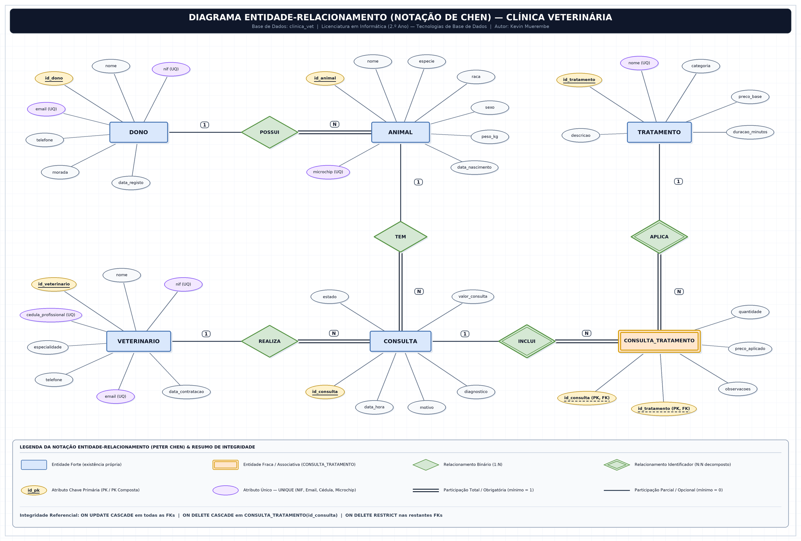

# Base de Dados — Clínica Veterinária

## Identificação do Projeto

- **Estudante:** Kevin Muerembe
- **Curso:** Licenciatura em Informática — 2.º Ano
- **Disciplina:** Tecnologias de Base de Dados
- **SGBD:** MySQL 8.0 (Motor InnoDB)
- **Repositório GitHub:** `bd-clinicaveterinaria-kevin-muerembe`
- **Link da Apresentação em Vídeo:** [LINK-VIDEO]

---

## 1. Tema e Justificação da Escolha

O presente projeto tem como tema a conceção, implementação e manipulação de uma **Base de Dados Relacional para a Gestão de uma Clínica Veterinária (`clinica_vet`)**.

A escolha deste domínio justifica-se por três razões principais:

1. **Originalidade e distinção face aos exemplos das aulas:** Afasta-se integralmente dos cenários clássicos abordados em contexto letivo — designadamente **biblioteca**, **universidade** e **vendas** — modelando um problema real da área da saúde animal com regras próprias de identificação eletrónica (microchip), especialidades clínicas, agendamento médico e histórico terapêutico.
2. **Riqueza concetual para Tecnologias de Base de Dados:** Permite aplicar de forma natural todos os conceitos fundamentais da disciplina: entidades fortes (`DONO`, `VETERINARIO`, `TRATAMENTO`, `ANIMAL`, `CONSULTA`), relacionamentos binários `1:N` com participações totais e parciais, decomposição de um relacionamento `N:N` através da entidade fraca/associativa `CONSULTA_TRATAMENTO` com atributos próprios (`quantidade`, `preco_aplicado`, `observacoes`), chaves únicas (`NIF`, `email`, `cedula_profissional`, `microchip`) e políticas diferenciadas de integridade referencial (`ON DELETE RESTRICT` e `ON DELETE CASCADE`).
3. **Continuidade direta para Programação Web:** A estrutura foi desenhada de raiz para suportar, sem necessidade de reformulação, a aplicação web completa a desenvolver na disciplina futura de **Programação Web**, cobrindo perfis distintos de utilizadores, formulários de registo/edição e vistas de pesquisa e faturação.

---

## 2. Descrição do Problema e Funcionamento do Sistema

Uma clínica veterinária de média dimensão acompanha diariamente dezenas de animais de companhia pertencentes a diversos clientes e conta com uma equipa multidisciplinar de médicos veterinários com diferentes áreas de especialização. Enquanto o controlo da atividade era efetuado recorrendo a fichas em papel e folhas de cálculo isoladas, verificavam-se problemas frequentes: duplicação de fichas de clientes, dificuldade em localizar rapidamente o historial clínico e vacinal de cada animal, erros na associação de microchips, conflitos na marcação de consultas e inconsistências no cálculo dos tratamentos realizados em cada atendimento.

Para resolver este problema, pretende-se informatizar integralmente a gestão clínica e administrativa através da base de dados `clinica_vet`. Sempre que um novo cliente recorre à clínica, os seus dados pessoais, número de identificação fiscal, telefone, correio eletrónico e morada são registados uma única vez como dono. A esse dono ficam associados um ou mais animais de companhia, caracterizados pelo nome, espécie, raça, sexo, data de nascimento, peso atual e número único de microchip quando aplicável. Do lado clínico, o sistema mantém o registo atualizado de todos os médicos veterinários, respetiva cédula profissional da Ordem dos Médicos Veterinários, especialidade e contactos, bem como um catálogo estruturado de tratamentos e procedimentos médicos com categoria, descrição técnica, duração estimada e preço base de tabela.

Sempre que um animal necessita de atendimento, é registada uma consulta numa data e hora específicas, associando obrigatoriamente um animal existente e o médico veterinário responsável, juntamente com o motivo da visita, o valor base da consulta, o estado do atendimento (`Agendada`, `Concluída` ou `Cancelada`) e, após observação médica, o respetivo diagnóstico clínico. Durante uma mesma consulta podem ser realizados zero, um ou vários tratamentos do catálogo — como vacinações, desparasitações, análises sanguíneas, exames imagiológicos ou intervenções cirúrgicas — e um mesmo tratamento do catálogo é aplicado em inúmeras consultas ao longo do tempo. Para guardar com rigor a quantidade administrada, o preço efetivamente praticado na data do ato médico e as observações clínicas específicas de cada procedimento sem perder o histórico quando os preços de tabela mudam no futuro, cada aplicação fica registada na tabela associativa `CONSULTA_TRATAMENTO`.

---

## 3. Regras de Negócio

1. **RN01 — Identificação única de clientes (`DONO`):** Cada dono possui um Número de Identificação Fiscal (`nif`) de 9 dígitos e um endereço de `email` únicos no sistema, não sendo permitidos registos duplicados.
2. **RN02 — Relação entre dono e animais (`1:N`):** Um dono pode ter zero, um ou vários animais registados na clínica (participação parcial), mas todo o animal registado tem obrigatoriamente um e um só dono associado (participação total).
3. **RN03 — Proteção de fichas de proprietários:** Não é permitido eliminar um dono da base de dados enquanto existirem animais associados ao seu identificador (`ON DELETE RESTRICT`).
4. **RN04 — Identificação eletrónica animal (`microchip`):** O atributo `microchip` é opcional para pequenos animais exóticos (como aves, hamsters ou tartarugas), mas quando preenchido tem de ser estritamente único em toda a tabela `ANIMAL`.
5. **RN05 — Credenciação dos médicos veterinários (`VETERINARIO`):** Cada médico veterinário é identificado de forma única pelo seu `nif`, pelo seu `email` institucional e pelo número de `cedula_profissional` atribuído pela Ordem dos Médicos Veterinários.
6. **RN06 — Obrigatoriedade de paciente e médico na consulta:** Toda a consulta registada refere-se obrigatoriamente a um único animal existente e a um único médico veterinário responsável (participação total de `CONSULTA` em ambos os relacionamentos `1:N`); inversamente, um animal recém-registado ou um veterinário recém-contratado podem ainda não ter consultas associadas (participação parcial).
7. **RN07 — Preservação do histórico médico:** Não é permitido apagar um animal nem um médico veterinário que já possuam consultas registadas na tabela `CONSULTA` (`ON DELETE RESTRICT`).
8. **RN08 — Ciclo de vida da consulta:** Uma consulta assume um dos estados `Agendada`, `Concluída` ou `Cancelada`; enquanto se encontra `Agendada` ou `Cancelada`, o campo `diagnostico` pode permanecer nulo (`NULL`), sendo preenchido aquando da conclusão clínica.
9. **RN09 — Decomposição `N:N` e dependência de existência (`CONSULTA_TRATAMENTO`):** Uma consulta pode incluir zero, um ou vários tratamentos distintos, e cada tratamento do catálogo pode ser aplicado em zero, uma ou várias consultas. A entidade fraca `CONSULTA_TRATAMENTO` usa a chave primária composta `(id_consulta, id_tratamento)` e depende existencialmente de `CONSULTA` (`ON DELETE CASCADE`).
10. **RN10 — Integridade do catálogo e preservação de preços históricos:** O registo em `CONSULTA_TRATAMENTO` guarda `preco_aplicado` no momento do ato médico para que futuras atualizações de `preco_base` em `TRATAMENTO` não alterem faturas antigas; além disso, apenas tratamentos sem qualquer consulta associada podem ser eliminados do catálogo (`ON DELETE RESTRICT`).

---

## 4. Diagrama Entidade-Relacionamento



---

## 5. Sistema Web Previsto (Ligação a Programação Web)

Esta base de dados servirá diretamente de suporte à aplicação web **VetGest Web** a desenvolver na disciplina de **Programação Web**.

### Perfis de Utilizadores

- **Rececionista / Administrador:** Gere fichas de clientes (`DONO`), fichas de pacientes (`ANIMAL`), equipa clínica (`VETERINARIO`), catálogo e preçário de atos médicos (`TRATAMENTO`), marcações/cancelamentos de consultas (`CONSULTA`) e faturação.
- **Médico Veterinário:** Consulta a sua agenda diária, acede ao historial clínico completo de cada animal, regista diagnósticos, altera o estado da consulta para `Concluída` e associa os tratamentos efetuados (`CONSULTA_TRATAMENTO`).
- **Cliente / Proprietário (`DONO`):** Acede à área reservada através do seu `email` para consultar os dados dos seus animais, verificar o boletim vacinal/histórico de tratamentos e acompanhar as próximas consultas agendadas.

### Funcionalidades Principais (CRUD Completo)

- **Registar (`INSERT`):** Formulários validados para inscrição de novos donos, registo de animais de companhia, cadastro de médicos veterinários e tratamentos, marcação de consultas e adição de tratamentos realizados em cada consulta.
- **Listar (`SELECT` / `JOIN`):** Listagens paginadas e ordenadas da agenda diária de consultas, diretório de clientes e animais, corpo clínico por especialidade, catálogo de preços e extrato detalhado de faturação por consulta.
- **Pesquisar (`SELECT` com `WHERE`):** Pesquisa rápida por NIF ou nome do dono, código de microchip, espécie/raça do animal, especialidade do veterinário, intervalo de datas ou estado da consulta (`Agendada`, `Concluída`, `Cancelada`).
- **Alterar (`UPDATE`):** Edição de contactos e morada de clientes, atualização de peso corporal e microchip do animal, registo de diagnóstico/conclusão de consultas e revisão de preços no catálogo de tratamentos.
- **Eliminar (`DELETE`):** Remoção controlada de registos obsoletos (como tratamentos do catálogo nunca utilizados ou itens de uma consulta em edição), respeitando rigorosamente as restrições de chave estrangeira da base de dados.

---

## 6. Estrutura do Repositório

```text
bd-clinicaveterinaria-kevin-muerembe/
├── README.md
├── diagrama_er.png
├── modelo_relacional.md
├── 01_criacao_e_insercao.sql
└── 02_manipulacao.sql
```

---

## 7. Tecnologias Utilizadas

- **MySQL 8.0 (InnoDB):** Sistema de Gestão de Base de Dados Relacional utilizado para definição do esquema DDL, chaves primárias/estrangeiras, restrições `UNIQUE` e manipulação DML/DQL com suporte integral a UTF-8 (`utf8mb4`).
- **MySQL Workbench 8.0:** Ambiente gráfico de administração e execução/validação dos scripts SQL.
- **draw.io (diagrams.net):** Modelação concetual do Diagrama Entidade-Relacionamento na notação de Peter Chen.
- **Markdown, Git e GitHub:** Documentação técnica estruturada, controlo de versões e alojamento público do projeto.
